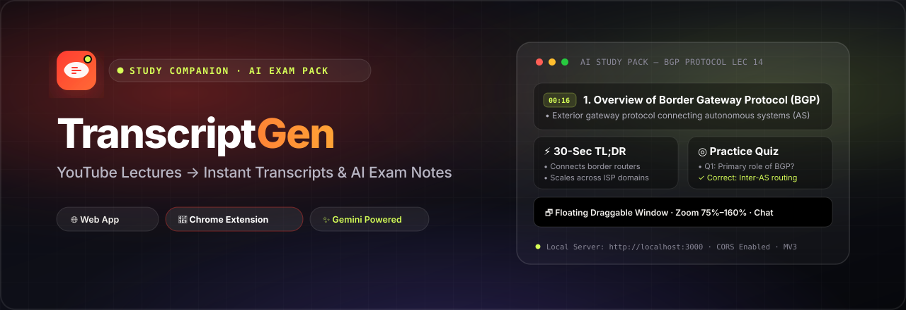

<p align="center">
  
</p>

<p align="center">
  <a href="#features"></a>
  <a href="#chrome-extension"></a>
  <a href="#api-reference"></a>
  <a href="#ai-study-pack-engine"></a>
  <a href="LICENSE"></a>
  <a href="https://github.com/Farhan0629/Youtube-Transcript/issues"></a>
</p>

---

## 📖 Overview

**TranscriptGen** is a study companion that transforms long YouTube lectures (especially dense NPTEL, university, and technical coursework) into structured exam revision material in seconds.

Instead of rewatching hours of video before midterms or finals, TranscriptGen extracts video transcripts and uses Google Gemini to generate exam-ready study packs: topic-wise structured notes with timestamp pills, 30-second TL;DRs, comprehensive detailed summaries, mathematical glossaries, self-testing practice quizzes, and an in-context chat tutor grounded exclusively in the lecture text.

TranscriptGen ships as both a **standalone web application** and a **Manifest V3 Chrome Extension** with a detachable floating window and responsive zoom controls.

---

## ⚡ Core Features

### 1. Robust Transcript Extraction
- **Multi-Client Innertube Fallback Sequence** — Tries Android, iOS, and Web player clients in parallel to bypass cloud datacenter IP blocks and bot captchas.
- **HTML Scraper Fallback** — Extracts raw `timedtext` endpoints directly from watch-page payloads when YouTube player APIs fail.
- **Paste Transcript Fallback Mode** — For private, region-restricted, or cloud-blocked videos, users can paste text directly from YouTube's native transcript drawer or their own lecture notes.
- **Smart Metadata Resolution** — Concurrently fetches titles and video metadata through YouTube oEmbed, noembed, and Android Innertube endpoints.

### 2. AI Study Pack Engine (Gemini)
- **Topic-Wise Structured Notes** — Organizes lecture content into sequential headings with concise bullet points and timestamp anchors (`[mm:ss]`).
- **Dual Summaries** — Offers a 30-second bulleted TL;DR for quick review and an exam-length detailed summary covering every subtopic.
- **Technical Glossary** — Extracts mathematical definitions, laws, formulas, and terminology into tabular format.
- **Practice Quiz Engine** — Automatically generates 10–12 multiple-choice questions with answer keys, distractors, and explanations grounded in the transcript.
- **"Ask the Lecture" Chat Tutor** — Context-bound Q&A assistant answering questions strictly from lecture content without hallucinating external facts.

### 3. Chrome Extension (Manifest V3)
- **Zero-Config Local Development** — Connects directly to `http://localhost:3000` on startup with no manual URL setup required.
- **Detachable Floating Window** — Pop the extension out into a standalone OS-level window using the **🗗 (Detach)** button to position it side-by-side with videos.
- **Smooth Zoom Controls** — Scale text and UI elements from 75% to 160% via header buttons, keyboard shortcuts (`Ctrl` + `+` / `Ctrl` + `-`), or mouse wheel.
- **Bring-Your-Own-Key (BYO Key) Support** — Enter a personal Gemini API key in extension settings to use personal quotas without server-side modifications.

---

## 🖥️ Feature Comparison

| Feature | Web Application | Chrome Extension (MV3) |
| :--- | :---: | :---: |
| Instant YouTube URL extraction | ✅ | ✅ |
| Paste transcript mode | ✅ | ✅ |
| Structured notes with timestamps | ✅ | ✅ |
| 30-sec TL;DR & Detailed summaries | ✅ | ✅ |
| Technical glossary & formula tables | ✅ | ✅ |
| Interactive MCQ practice quiz | ✅ | ✅ |
| Lecture-grounded AI chat tutor | ✅ | ✅ |
| One-click clipboard & text export | ✅ | ✅ |
| Markdown study pack download | ✅ | ✅ |
| One-click active tab auto-fill | ❌ | ✅ |
| Detachable floating window | ❌ | ✅ |
| Responsive UI zoom controls | ❌ | ✅ |
| Optional client-side Gemini key override | ❌ | ✅ |

---

## 📁 Repository Structure

```
TranscriptGen/
├── assets/
│   └── banner.svg             # Vector project banner for GitHub README
├── api/
│   └── index.js               # Vercel serverless function entrypoint
├── lib/
│   └── gemini.js              # Gemini SDK wrapper, prompt schemas, and LRU cache
├── public/                    # Web frontend (vanilla HTML/CSS/JS, zero build step)
│   ├── index.html             # Web app layout and dark/light UI shells
│   ├── styles.css             # Glassmorphic responsive dark theme
│   ├── app.js                 # Transcript controller and view rendering
│   └── ai.js                  # Study pack generation and chat interface
├── extension/                 # Chrome Extension (Manifest V3)
│   ├── manifest.json          # MV3 configuration, actions, and permissions
│   ├── popup.html             # Toolbar popup and floating window layout
│   ├── popup.css              # Extension stylesheet with zoom and detached styles
│   ├── popup.js               # Extension controller and API bridge
│   ├── background.js          # Service worker and CORS relay
│   ├── options.html           # Settings UI for backend URL and personal key
│   ├── options.js             # Storage management and connection tester
│   └── icons/                 # Extension icons (16px, 48px, 128px)
├── server.js                  # Express 5 backend server and API endpoints
├── package.json               # Node.js project manifest and dependencies
├── vercel.json                # Vercel deployment routing configuration
├── render.yaml                # Render web service blueprint
├── .env.example               # Environment variable templates
└── README.md                  # Project documentation
```

---

## 🚀 Quickstart & Local Setup

### Prerequisites

- [Node.js](https://nodejs.org/) v18.0.0 or higher
- A Google AI Studio Gemini API key (optional for transcript extraction, required for AI features) — get one free at [aistudio.google.com](https://aistudio.google.com)

### 1. Clone & Install Dependencies

```bash
git clone https://github.com/Farhan0629/Youtube-Transcript.git
cd Youtube-Transcript
npm install
```

### 2. Configure Environment Variables

Create a `.env` file in the project root:

```bash
cp .env.example .env
```

Open `.env` and insert your Gemini API key:

```env
GEMINI_API_KEY=your_gemini_api_key_here
# Optional: defaults to gemini-3.8-flash
# GEMINI_MODEL=gemini-3.8-flash
```

### 3. Start the Server

```bash
npm start
```

The server will start at `http://localhost:3000`. You can open this URL in any browser to use the web application immediately.

---

## 🧩 Installing the Chrome Extension

1. Ensure your backend server is running (`npm start`).
2. Open Google Chrome and navigate to `chrome://extensions`.
3. Enable **Developer mode** via the toggle in the top-right corner.
4. Click **Load unpacked** in the top-left corner.
5. Select the `extension/` directory inside this repository.
6. Click the extension puzzle icon in Chrome and **pin TranscriptGen** to your toolbar.

### Using the Extension

- **Standard Popup:** Click the extension icon on any YouTube video tab. Click **"Use current tab URL"** → **"Extract transcript"** → **"✨ Generate"**.
- **Floating Draggable Window:** Click the **🗗 (Detach)** icon in the top header. TranscriptGen pops out into an independent window that you can drag anywhere across your desktop or snap alongside your video.
- **Zoom Controls:** Click `＋` or `－` in the header (or hold `Ctrl` and scroll) to adjust text size from 75% to 160%.

---

## 🔌 API Reference

### Transcript Endpoints

#### `POST /api/transcript`
Extracts transcripts from YouTube videos using parallel client fallbacks.

**Request Body:**
```json
{
  "url": "https://www.youtube.com/watch?v=7ZQbS0bCMlg",
  "lang": "en"
}
```

**Response (`200 OK`):**
```json
{
  "videoId": "7ZQbS0bCMlg",
  "title": "Lecture 14 - Border Gateway Protocol (BGP)",
  "url": "https://www.youtube.com/watch?v=7ZQbS0bCMlg",
  "language": "en",
  "segmentCount": 769,
  "charCount": 28410,
  "wordCount": 5122,
  "durationApprox": "42:15",
  "text": "Full plain transcript text...",
  "timestamped": "[00:16] Overview of BGP...",
  "segments": [
    { "text": "Overview of BGP", "offset": 16000, "duration": 3500 }
  ],
  "elapsedMs": 420
}
```

#### `POST /api/transcript/custom`
Parses and normalizes pasted text from YouTube's native transcript drawer or student notes.

**Request Body:**
```json
{
  "text": "00:00 Introduction\n01:15 Core Concepts",
  "title": "Distributed Systems Lec 4",
  "url": "https://youtube.com/watch?v=..."
}
```

---

### AI Endpoints

#### `POST /api/ai/study-pack`
Generates comprehensive study materials from transcript text.

**Headers:**
- `Content-Type: application/json`
- `x-gemini-key` *(Optional)*: Client-supplied personal Gemini API key
- `x-gemini-model` *(Optional)*: Model override (e.g. `gemini-2.0-flash`)

**Request Body:**
```json
{
  "videoId": "7ZQbS0bCMlg",
  "title": "Lecture 14 - Border Gateway Protocol (BGP)",
  "text": "Full transcript text...",
  "segments": []
}
```

**Response (`200 OK`):**
```json
{
  "videoId": "7ZQbS0bCMlg",
  "title": "Lecture 14 - Border Gateway Protocol (BGP)",
  "summaryTLDR": [
    "BGP is the standardized exterior gateway protocol for the internet.",
    "Operates over TCP port 179 between autonomous systems."
  ],
  "summaryDetailed": "Comprehensive review of inter-domain routing...",
  "structuredNotes": [
    {
      "heading": "1. Overview of Border Gateway Protocol",
      "bullets": [
        "Exterior gateway protocol connecting autonomous systems",
        "Primarily utilized by ISPs and large cloud providers"
      ],
      "timestamp": "00:16"
    }
  ],
  "glossary": [
    { "term": "Autonomous System (AS)", "definition": "A connected group of IP networks under unified administrative control." }
  ],
  "quiz": [
    {
      "id": 1,
      "q": "Which transport protocol does BGP use for session establishment?",
      "options": ["UDP", "TCP", "SCTP", "ICMP"],
      "answerIndex": 1,
      "answerLetter": "B",
      "explanation": "BGP establishes peering sessions over TCP port 179."
    }
  ],
  "model": "gemini-3.8-flash"
}
```

#### `POST /api/ai/chat`
Answers student questions strictly grounded in the transcript text.

**Request Body:**
```json
{
  "videoId": "7ZQbS0bCMlg",
  "title": "Lecture 14 - BGP",
  "text": "Full transcript text...",
  "question": "What is the primary difference between iBGP and eBGP?",
  "history": []
}
```

**Response (`200 OK`):**
```json
{
  "answer": "iBGP runs between routers in the same Autonomous System, whereas eBGP connects border routers between different Autonomous Systems...",
  "model": "gemini-3.8-flash"
}
```

#### `GET /api/health`
Checks server availability and Gemini key status. Returns `{ "ok": true, "ai": true }`.

---

## ☁️ Deployment

### Deploy to Vercel

1. Push your repository to GitHub.
2. In the Vercel dashboard, click **Add New Project** and import the repository.
3. Framework Preset: select **Other**.
4. In **Environment Variables**, add:
   - `GEMINI_API_KEY`: your Google AI Studio key.
5. Click **Deploy**. Vercel will build the frontend assets and host the backend through serverless routes mapped in `vercel.json`.

### Deploy to Render

This repository includes a `render.yaml` blueprint:

1. Connect your repository to Render.
2. Create a new **Blueprint Instance**.
3. Supply `GEMINI_API_KEY` under environment secrets.
4. Render will deploy the web service using `npm start`.

---

## 🔒 Security & Privacy

- **No Data Retention** — TranscriptGen does not store student queries or video transcripts in a database.
- **LRU In-Memory Cache** — AI generations are temporarily cached in server memory for 60 minutes to protect your API quota from repeated requests on the same lecture.
- **Encrypted Local Storage** — Custom keys and API bases entered in the Chrome extension are stored solely in your browser's sandboxed `chrome.storage.sync` / `chrome.storage.local`.
- **Zero Third-Party Telemetry** — No analytics scripts, tracker cookies, or remote logging libraries are loaded.

---

## 🤝 Contributing

Contributions, bug reports, and suggestions are welcome!

1. Fork this repository.
2. Create a feature branch: `git checkout -b feature/awesome-feature`.
3. Commit your changes: `git commit -m "feat: add awesome feature"`.
4. Push to your branch: `git push origin feature/awesome-feature`.
5. Open a Pull Request.

---

## 📄 License

This project is licensed under the [ISC License](LICENSE).
